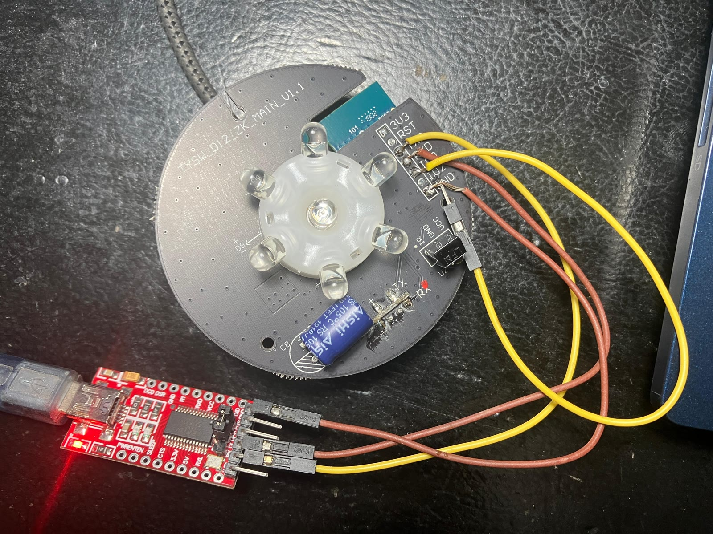
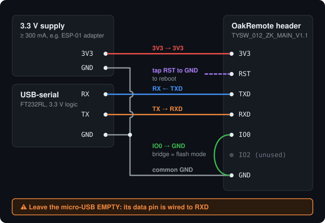

# Oakter OakRemote → Tasmota


The **Oakter OakRemote** is a Wi-Fi IR blaster sold in India. It only works through Oakter's cloud (`live.oakter.com`), and in October 2026 that server stopped answering. From then on, every OakRemote just sits on your Wi-Fi doing nothing: the app still shows "Connected", but commands go nowhere, and Alexa can't control your TV or AC.

Inside, it's an ordinary ESP8266. This repo shows how to reflash it with [Tasmota](https://tasmota.github.io/) so it works **fully locally**: learn codes from your original remote, send them from a web page or Home Assistant, and control them with Alexa, with no cloud at all.

Done on a unit with board `TYSW_012_ZK_MAIN_V1.1`. Other revisions may differ, so check your board first.

## What's inside

| Part | Details |
|---|---|
| Wi-Fi module | **TYWE3S** (Tuya, ESP8266EX, 1 MB flash), marked ZK13 |
| Header | Unpopulated holes labelled `3V3 RST TXD RXD IO0 IO2 GND` |
| IR | 7 IR LEDs driven through transistors Q1–Q4, plus an IR receiver (U2) |
| Other | Blue status LED, pinhole button S1, micro-USB 5 V in, AMS1117 regulator |

**Tasmota template** (all pins confirmed on hardware):

```json
{"NAME":"OakRemote IR","GPIO":[1,1,1,1,320,1088,0,0,0,32,1056,0,0,0],"FLAG":0,"BASE":62}
```

| GPIO | Function |
|---|---|
| 14 | IR send |
| 5 | IR receive |
| 4 | Blue LED (inverted) |
| 13 | Pinhole button |

> The stock firmware stores **no IR codes**: Oakter's cloud sent them with every button press. Once the cloud is gone, they're gone too, so you'll learn your codes again from the original remotes (see [Learning codes](#learning-codes)).

## Flashing





You need a USB-serial adapter that can do 3.3 V logic (I used an FT232RL) and a separate 3.3 V supply. The FT232RL's own 3.3 V pin can't supply enough current for the ESP8266. An ESP-01 adapter board's regulator worked.

1. **Solder wires to the header.** Holding pins against the holes by hand gave noise and no bootloader sync.
2. **Leave the micro-USB port empty.** This is the trap that cost the most time: the header's **RXD is wired to a micro-USB data pin**. Anything plugged in there (a PC *or* a charger) pulls RXD up, and the bootloader never hears the flasher. Power the board through the `3V3` hole instead.
3. Wire it up as in the diagram: adapter TX → `RXD`, adapter RX ← `TXD`, all grounds together, 3.3 V → `3V3`.
4. Bridge `IO0` to `GND`, then tap `RST` to `GND` to reboot into the bootloader. At 74880 baud the ROM prints `boot mode:(1,7)` when it's waiting for a flash.
5. **Back up the stock firmware first.** It can't be downloaded anywhere else:
   ```sh
   pip install esptool
   esptool --port /dev/ttyUSB0 read-flash 0 ALL oakremote-stock-backup.bin   # 1 MB
   ```
   Don't share this file: it contains your Wi-Fi password and the device's Tuya keys.
6. Flash Tasmota's IR build ([`tasmota-ir.bin`](https://ota.tasmota.com/tasmota/release/)):
   ```sh
   esptool --port /dev/ttyUSB0 erase-flash
   esptool --port /dev/ttyUSB0 write-flash 0 tasmota-ir.bin
   ```
7. Remove the `IO0` bridge and power-cycle. Join the `tasmota-xxxx` Wi-Fi access point, enter your Wi-Fi details, then on the device's web UI go to *Configuration → Other*, paste the template above and select it.

**Recovery without soldering:** press the pinhole button **4 times quickly** to start Tasmota's Wi-Fi manager.

## Learning codes

Point the original remote at the blaster and press a button. Tasmota prints the code in its console:

```
{"IrReceived":{"Protocol":"NEC","Bits":32,"Data":"0x04FB7887"}}
```

To send it:

```
IRsend {"Protocol":"NEC","Bits":32,"Data":"0x04FB7887"}
```

[`web/`](web/) contains a small page for doing this from your phone: tap **Learn**, press the button on the original remote, then tap **Test**. Codes are saved on the server.
- `oakremote.html` is the page. `oak.php` is a small helper (PHP 8.1+) that talks to the blaster. Set `TASMOTA` and `STORE` at the top of `oak.php`.
- The helper is needed because **Tasmota 16 drops `/cm` and `/cs` requests that don't carry a `Referer` from its own host** (curl gets an empty reply), so a browser page can't call it directly.
- **Keep it on your LAN.** Anyone who can reach `oak.php` can send IR commands to your devices. [`web/.htaccess`](web/.htaccess) restricts it to local addresses on Apache.

### Nakamichi home theatre codes

These are from a Nakamichi DVD home-theatre receiver (NEC, address `0x04FB`), in case you have the same one:

| Button | Code |
|---|---|
| Power (toggle) | `0x04FB7887` |
| Volume + | `0x04FBC23D` |
| Volume − | `0x04FB7A85` |
| Audio Source (AUX → MP3 → iPod) | `0x04FBF807` |

## Alexa

The `tasmota-ir` build has **no Alexa emulation**, so switch to the standard `tasmota` build once your codes work. It sends and receives common protocols like NEC fine.

- **Upgrading needs two steps.** The flash is only 1 MB, so go ir → `tasmota-minimal` → `tasmota`.
- **The ESP8266 can only download updates over plain HTTP.** If `http://ota.tasmota.com` won't load from your network, download the files over HTTPS on a PC, serve them from any local web server, and point `OtaUrl` at it.

Then paste [`tasmota/alexa-setup.txt`](tasmota/alexa-setup.txt) into the console. It sets up:
- 5 *virtual* relays on unused pins (template: [`tasmota/template-alexa.json`](tasmota/template-alexa.json)), with Hue emulation (`Emulation 2`). Each relay appears in Alexa as a device.
- Rules that turn each relay into IR commands. For example, "HT Power" **on** = power, wait 6 s, select AUX, hold Vol+ to maximum; **off** = power.

Things that went wrong along the way:
- **`PulseTime` 0.1 s makes Alexa say "sorry".** The device is already off again when Alexa checks, so use `PulseTime 20` (2 s).
- **Don't name a device "Home Theatre".** Alexa then grabs "Home Theatre volume up" as a device command and answers "doesn't support that". Prefixed names (`HT Power`, `HT Vol Up` …) plus Alexa routines with your own phrases work better.
- **Changing a relay's state to "sync" it sends the IR code.** Power toggles are blind, so setting `Power1` to match reality turns the receiver off.

## Files

```
images/       photos
docs/         wiring diagram
tasmota/      templates + Alexa console commands
web/          IR learning page (HTML + PHP helper)
```

## License

MIT. See [LICENSE](LICENSE). Not affiliated with Oakter. Opening and reflashing your device voids any warranty; do it at your own risk.
